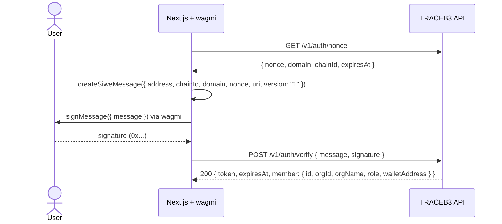

# TRACEB3 Frontend Handoff Guide (Next.js + wagmi)

This guide is written directly for the Next.js + `wagmi` frontend engineer integrating with the **TRACEB3 Backend API**.

---

## 1. Quick Boot Local Backend (< 5 Minutes)

```bash
# 1. Install monorepo dependencies
pnpm install

# 2. Boot local Hardhat node + deploy TraceB3Ledger + migrate PGlite + start API + seed Jababeka demo actors
pnpm dev:all
```

Once ready, you have:
- **API Base URL:** `http://127.0.0.1:3001`
- **Scalar Interactive Docs:** `http://127.0.0.1:3001/docs`
- **OpenAPI 3.1 JSON:** `http://127.0.0.1:3001/openapi.json`
- **Demo Wallets & Private Keys:** Saved to `.env.demo` (import into MetaMask/Rabby or use in tests)
- **Verify everything end-to-end anytime:** `pnpm demo:e2e -- --self-hosted` (or `pnpm demo:e2e` against the running stack)

---

## 2. Authentication Flow (SIWE — EIP-4361)



### Copy-Pasteable `wagmi` + `viem` SIWE Login Snippet

```typescript
import { createSiweMessage } from 'viem/siwe';
import { useAccount, useSignMessage } from 'wagmi';

export async function loginWithSiwe(params: {
  apiUrl: string;
  address: `0x${string}`;
  signMessageAsync: ReturnType<typeof useSignMessage>['signMessageAsync'];
}) {
  const nonceRes = await fetch(`${params.apiUrl}/v1/auth/nonce`);
  if (!nonceRes.ok) throw new Error('Failed to fetch SIWE nonce');
  const { nonce, domain, chainId } = (await nonceRes.json()) as {
    nonce: string;
    domain: string;
    chainId: number;
  };

  const message = createSiweMessage({
    address: params.address,
    chainId,
    domain,
    nonce,
    uri: window.location.origin,
    version: '1',
    statement: 'Sign in to TRACEB3 Digital Waste Passport',
  });

  const signature = await params.signMessageAsync({ message });

  const verifyRes = await fetch(`${params.apiUrl}/v1/auth/verify`, {
    method: 'POST',
    headers: { 'Content-Type': 'application/json' },
    body: JSON.stringify({ message, signature }),
  });
  if (!verifyRes.ok) {
    throw await verifyRes.json(); // RFC 9457 ProblemDetails
  }

  return (await verifyRes.json()) as {
    token: string;
    expiresAt: string;
    member: {
      id: string;
      orgId: string;
      orgName: string;
      role: 'GENERATOR' | 'TRANSPORTER' | 'FACILITY' | 'AUDITOR' | 'ADMIN';
      walletAddress: string;
      displayName: string;
    };
  };
}
```

---

## 3. Gasless Custody Flow (`INTENT -> SIGN -> SUBMIT`)

Users **never pay gas** and **never submit blockchain transactions directly**. The backend builds the RFC 8785 canonical record and EIP-712 `CustodyIntent` payload; the user signs with `useSignTypedData`, and the backend relayer anchors it on-chain.

```mermaid
sequenceDiagram
    actor Actor as Wallet (Generator / Transporter / Facility)
    participant FE as Next.js + wagmi
    participant API as TRACEB3 API

    opt With manifest or weighbridge photo
        FE->>API: POST /v1/batches/:idOrStaging/evidence (multipart/form-data)
        API-->>FE: 201 { id, sha256, mimeType, sizeBytes }
    end
    FE->>API: POST /v1/intents { kind, batchId?, data, evidenceIds }
    API-->>FE: 201 { intentId, batchId, seq, eventHash, typedData, eventPreview, expiresAt }
    FE->>Actor: signTypedData(typedData) via wagmi
    Actor-->>FE: signature (0x...)
    FE->>API: POST /v1/intents/:id/submit (Header: Idempotency-Key) { signature }
    API-->>FE: 202 { eventId, batchId, seq, status: "PENDING", eventHash }
    FE->>API: GET /v1/events/:id/stream (SSE) or poll GET /v1/events/:id/status
    API-->>FE: { chainStatus: "ANCHORED", txHash, blockNumber, anchoredAt, explorerUrl }
```

### Copy-Pasteable `wagmi` `useSignTypedData` Snippet

Note: Over JSON, `typedData.message.nonce` and `typedData.message.deadline` arrive as decimal strings (JSON cannot serialize `bigint`). Convert them to `BigInt(...)` (or call `deserializeTypedData(typedData)` from `@traceb3/core`).

```typescript
import { deserializeTypedData, type CustodyIntentTypedDataJson } from '@traceb3/core';
import { useSignTypedData } from 'wagmi';

export async function signAndSubmitCustodyIntent(params: {
  apiUrl: string;
  jwt: string;
  payload: {
    kind: 'CREATED' | 'CUSTODY_TRANSFERRED' | 'REVISION' | 'TREATMENT';
    batchId?: string;
    data: {
      batchRef?: string;
      wasteCode?: string;
      wasteName?: string;
      quantity?: { value: string; unit: 'kg' | 'g' | 'ton' };
      targetSeq?: number;
      reasonCode?:
        | 'SCALE_RECALIBRATION'
        | 'UNIT_CORRECTION'
        | 'DATA_ENTRY_ERROR'
        | 'MANIFEST_AMENDMENT'
        | 'OTHER';
      notes?: string;
      festronikRef?: string;
      monijaRef?: string;
    };
    evidenceIds?: string[];
  };
  signTypedDataAsync: ReturnType<typeof useSignTypedData>['signTypedDataAsync'];
}) {
  // 1. Prepare canonical event & EIP-712 payload
  const intentRes = await fetch(`${params.apiUrl}/v1/intents`, {
    method: 'POST',
    headers: {
      'Content-Type': 'application/json',
      Authorization: `Bearer ${params.jwt}`,
    },
    body: JSON.stringify({
      ...params.payload,
      evidenceIds: params.payload.evidenceIds ?? [],
    }),
  });
  if (!intentRes.ok) throw await intentRes.json();

  const intent = (await intentRes.json()) as {
    intentId: string;
    batchId: string;
    seq: number;
    eventHash: string;
    typedData: CustodyIntentTypedDataJson;
    expiresAt: string;
  };

  // 2. Sign typedData with user's connected wallet
  const typedData = deserializeTypedData(intent.typedData);
  const signature = await params.signTypedDataAsync({
    domain: typedData.domain,
    types: typedData.types,
    primaryType: typedData.primaryType,
    message: typedData.message,
  });

  // 3. Submit signed intent with an Idempotency-Key
  const submitRes = await fetch(
    `${params.apiUrl}/v1/intents/${intent.intentId}/submit`,
    {
      method: 'POST',
      headers: {
        'Content-Type': 'application/json',
        Authorization: `Bearer ${params.jwt}`,
        'Idempotency-Key': crypto.randomUUID(),
      },
      body: JSON.stringify({ signature }),
    },
  );
  if (!submitRes.ok) throw await submitRes.json();

  return (await submitRes.json()) as {
    eventId: string;
    batchId: string;
    seq: number;
    status: 'PENDING';
    eventHash: string;
  };
}
```

---

## 4. Evidence Upload & Signed Download

- **Before batch creation (`CREATED`):** Upload to `POST /v1/batches/staging/evidence`.
- **For existing batches (`CUSTODY_TRANSFERRED`, `REVISION`, `TREATMENT`):** Upload to `POST /v1/batches/${batchId}/evidence`.
- Send `multipart/form-data` with field `file` (`File`/`Blob`) and optional string `label`.
- Accepted types (verified via magic bytes): `application/pdf`, `image/jpeg`, `image/png`, `image/webp` (max `MAX_UPLOAD_MB`, default `10 MB`).
- Pass returned `id` inside `evidenceIds: [id]` on `POST /v1/intents`.
- **Downloading:** Call `GET /v1/evidence/${evidenceId}/download` with Bearer JWT -> receive `{ url, expiresInSeconds, sha256, filename }` -> open `url` directly in browser/download link.

---

## 5. Tracking Anchor Status (SSE Stream & Polling)

### Option A — Real-Time SSE (`GET /v1/events/:id/stream`)
Note: Native browser `EventSource` cannot send `Authorization` headers; use `@microsoft/fetch-event-source` or `fetch()` stream reading with `Bearer ${jwt}`:

```typescript
export async function watchEventStream(
  apiUrl: string,
  eventId: string,
  jwt: string,
  onStatus: (update: {
    eventId: string;
    chainStatus: 'PENDING' | 'SUBMITTED' | 'ANCHORED' | 'FAILED';
    txHash: string | null;
    blockNumber: number | null;
    anchoredAt: string | null;
    failureReason: string | null;
    explorerUrl: string | null;
  }) => void,
) {
  const res = await fetch(`${apiUrl}/v1/events/${eventId}/stream`, {
    headers: { Authorization: `Bearer ${jwt}` },
  });
  if (!res.ok || !res.body) throw new Error(`SSE failed: ${res.status}`);

  const reader = res.body.getReader();
  const decoder = new TextDecoder();
  let buffer = '';

  while (true) {
    const { done, value } = await reader.read();
    if (done) break;
    buffer += decoder.decode(value, { stream: true });
    const frames = buffer.split('\n\n');
    buffer = frames.pop() ?? '';
    for (const frame of frames) {
      const dataLine = frame.split('\n').find((l) => l.startsWith('data:'));
      if (dataLine) {
        const parsed = JSON.parse(dataLine.slice(5).trim());
        if (parsed.chainStatus) onStatus(parsed);
      }
    }
  }
}
```

### Option B — Simple Polling (`GET /v1/events/:id/status`)
Poll every `1500ms` until `chainStatus === 'ANCHORED'` or `'FAILED'`.

---

## 6. QR URL Format & Public Passport Pages

- **QR Payload Encoded by Backend (`GET /v1/batches/:id/qr?format=png|svg`):**
  `${PUBLIC_APP_URL}/p/${publicId}` (e.g., `http://localhost:3000/p/V1StGXR8_Z5jdHi6`)
- **Frontend Route `/p/[publicId]` should fetch:**
  1. `GET /v1/public/passports/${publicId}` — Displays summary & custody timeline (`viewLevel: 'redacted' | 'full'`).
  2. `GET /v1/public/passports/${publicId}/verify` — Displays live **tamper-evident** verification badge (`VERIFIED | TAMPERED | PENDING | INCOMPLETE`) and names any `affectedEvents` / `affectedFiles`.
  3. `GET /v1/public/passports/${publicId}/proof-bundle` — Optional "Download Proof Bundle (JSON)" button for offline/RPC verification.

---

## 7. Shared Types, Enums & `@traceb3/sdk`

You can install `@traceb3/sdk` inside the monorepo or copy `@traceb3/core` types. Using `@traceb3/sdk`:

```typescript
import {
  createTraceB3Client,
  normalizeWeightToGrams,
  formatGramsAsKg,
} from '@traceb3/sdk';

const client = createTraceB3Client(process.env.NEXT_PUBLIC_API_URL!, {
  getToken: () => localStorage.getItem('traceb3_jwt') ?? undefined,
});

const batchesRes = await client.v1.batches.$get({
  query: { status: 'RECEIVED', limit: '20', offset: '0' },
});
```

### Enums Reference
- **`ActorRole`:** `GENERATOR | TRANSPORTER | FACILITY | AUDITOR | ADMIN`
- **`OrgType`:** `generator | transporter | facility | regulator`
- **`BatchStatus`:** `PENDING_CHAIN | REGISTERED | IN_TRANSIT | RECEIVED | TREATED`
- **`EventType`:** `CREATED | CUSTODY_TRANSFERRED | REVISION | TREATMENT`
- **`ChainStatus`:** `PENDING | SUBMITTED | ANCHORED | FAILED`
- **`WeightUnit`:** `kg | g | ton`
- **`ReasonCode`:** `SCALE_RECALIBRATION | UNIT_CORRECTION | DATA_ENTRY_ERROR | MANIFEST_AMENDMENT | OTHER`
- **`DiscrepancyCode`:** `WEIGHT_MISMATCH_PICKUP | WEIGHT_MISMATCH_DELIVERY | WEIGHT_MISMATCH_TOTAL | LIKELY_UNIT_ERROR | CUSTODY_GAP | VALUE_REVISED`
- **`DiscrepancySeverity`:** `none | info | warning | critical`
- **`EventVerificationVerdict`:** `MATCH | HASH_MISMATCH | FILE_MISMATCH | FILE_MISSING | NOT_YET_ANCHORED | CHAIN_LINK_BROKEN | SIGNATURE_INVALID`
- **`OverallVerificationVerdict`:** `VERIFIED | TAMPERED | PENDING | INCOMPLETE`

### Example Payloads

**`POST /v1/intents` (`CREATED`):**
```json
{
  "kind": "CREATED",
  "data": {
    "batchRef": "TB3-2026-000123",
    "wasteCode": "B105d",
    "wasteName": "Spent Industrial Solvent",
    "quantity": { "value": "850", "unit": "kg" },
    "festronikRef": "FEST-2026-0042",
    "notes": "Drums sealed at Warehouse B"
  },
  "evidenceIds": ["01950000-0000-7000-8000-000000000010"]
}
```

**`POST /v1/intents` (`REVISION`):**
```json
{
  "kind": "REVISION",
  "batchId": "01950000-0000-7000-8000-000000000001",
  "data": {
    "targetSeq": 3,
    "reasonCode": "SCALE_RECALIBRATION",
    "quantity": { "value": "845", "unit": "kg" },
    "notes": "Reweighed after certified scale calibration"
  },
  "evidenceIds": []
}
```

---

## 8. CORS & Error Handling (RFC 9457)

- Add your Next.js origin (e.g., `http://localhost:3000`) to `FRONTEND_ORIGINS` (comma-separated).
- Allowed headers: `Content-Type`, `Authorization`, `Idempotency-Key`, `X-Request-Id`.
- Exposed headers: `X-Request-Id`, `Content-Disposition`, `Retry-After`.
- Every error returns `Content-Type: application/problem+json` with a stable machine `code`:
  `UNAUTHENTICATED` (`401`), `FORBIDDEN_ROLE` (`403`), `VALIDATION_ERROR` (`400`), `BAD_SIGNATURE` (`400`), `NOT_FOUND` (`404`), `BATCH_BUSY` (`409`), `INVALID_TRANSITION` (`409`), `INTENT_EXPIRED` (`410`), `EVIDENCE_TOO_LARGE` (`413`), `EVIDENCE_TYPE_NOT_ALLOWED` (`415`), `CHAIN_REVERT` (`422`), `RATE_LIMITED` (`429`), `CHAIN_UNAVAILABLE` (`503`), `INTERNAL_ERROR` (`500`).
